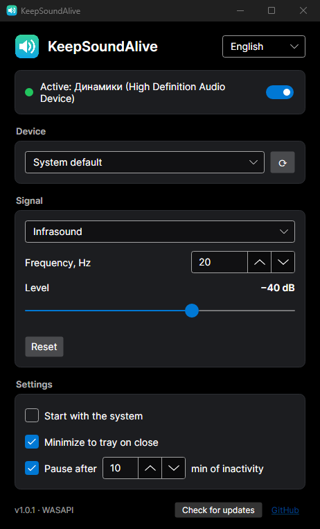

<p align="center">
  
</p>

<h1 align="center">KeepSoundAlive</h1>

<p align="center">
  Keeps your speakers awake, so sound is never cut off at the start.<br>
  Windows and Linux · a single file, nothing to install
</p>

<p align="center">
  <a href="https://github.com/labpak/KeepSoundAlive/releases/latest"></a>
</p>

<p align="center"><a href="README.md">Русский</a></p>

<p align="center">
  
</p>

Many speakers, soundbars, Bluetooth and HDMI devices switch their amplifier off after a few seconds of silence.
When sound starts again they need 1–3 seconds to wake up, and the beginning of the sound is lost.
KeepSoundAlive plays an inaudible signal to the device, so it stays awake.

## Download

| System | File |
|---|---|
| **Windows 10 / 11** | [**KeepSoundAlive-win-x64.exe**](https://github.com/labpak/KeepSoundAlive/releases/latest/download/KeepSoundAlive-win-x64.exe) |
| **Linux** | [**KeepSoundAlive-linux-x64**](https://github.com/labpak/KeepSoundAlive/releases/latest/download/KeepSoundAlive-linux-x64) |
| Windows on ARM (Snapdragon, Surface Pro X) | [KeepSoundAlive-win-arm64.exe](https://github.com/labpak/KeepSoundAlive/releases/latest/download/KeepSoundAlive-win-arm64.exe) |
| Linux on ARM (Raspberry Pi 4/5, 64-bit) | [KeepSoundAlive-linux-arm64](https://github.com/labpak/KeepSoundAlive/releases/latest/download/KeepSoundAlive-linux-arm64) |

Not sure? Take the first row for Windows or the second one for Linux.
All versions: [Releases](https://github.com/labpak/KeepSoundAlive/releases).

## Install

### Windows

1. Download `KeepSoundAlive-win-x64.exe` and run it.
2. If you see "Windows protected your PC", click **More info → Run anyway**
   (the file has no paid code-signing certificate).
3. Turn on "Start with the system" and close the window — the app keeps running in the tray.

> Before turning on autostart, put the file where it will stay (not in Downloads).

**Or with one PowerShell command** — installs to `%LOCALAPPDATA%\Programs\KeepSoundAlive`, adds a Start menu
shortcut and starts the app:

```powershell
irm https://raw.githubusercontent.com/labpak/KeepSoundAlive/main/install.ps1 | iex
```

### Linux

**With one command** — installs to `~/.local/bin`, adds an applications menu entry and starts the app:

```sh
curl -fsSL https://raw.githubusercontent.com/labpak/KeepSoundAlive/main/install.sh | sh
```

**Or manually:**

```sh
chmod +x KeepSoundAlive-linux-x64
./KeepSoundAlive-linux-x64
```

Works with PipeWire, PulseAudio and ALSA. On GNOME the tray icon needs the
[AppIndicator](https://extensions.gnome.org/extension/615/appindicator-support/) extension; without it, start the
app again to bring its window back.

### Updating

Click **"Check for updates"** at the bottom of the window, then **"Update to …"**. The app downloads the new version,
verifies its checksum and restarts. It only goes online when you press this button, and only to GitHub.

Version 1.0.0 (it has no button yet) has to be updated manually once: download the new file or run the install
command again.

## If the speakers still fall asleep

- Raise the **Level** by 5–10 dB.
- Try another **Signal**: "Quiet noise", or "Ultrasound" for wired speakers.
- If it's the HDMI or USB audio that sleeps rather than the speakers, the "Silence" mode is enough.
- If the speakers fall asleep only after the computer has been unused for a while, that's the pause that lets
  Windows sleep: the signal stops after N minutes with neither mouse/keyboard input nor sound from other apps.
  Increase the time or untick "Pause after … min of inactivity".

## Uninstall

- **Windows:** turn off "Start with the system", exit from the tray menu and delete the exe.
  Settings are in `%APPDATA%\KeepSoundAlive`.
- **Linux:** turn off autostart and the menu entry in the app's settings, then delete
  `~/.local/bin/KeepSoundAlive` and `~/.config/KeepSoundAlive`.

<details>
<summary><b>Command line</b></summary>

```
KeepSoundAlive [options]
  --minimized      start in the tray
  --headless       run without a window using the saved settings (servers, SSH); Ctrl+C to stop
  --list-devices   list output devices
  --add-to-menu    (Linux) add to the applications menu
  --update         download and install the latest version
  --help           help
```
</details>

<details>
<summary><b>Building from source</b></summary>

Requires the [.NET 10 SDK](https://dotnet.microsoft.com/download).

```sh
dotnet run --project src/KeepSoundAlive
dotnet publish src/KeepSoundAlive -c Release -r win-x64    # or linux-x64, win-arm64, linux-arm64
```

C# / .NET 10, [Avalonia UI](https://avaloniaui.net/), [NAudio](https://github.com/naudio/NAudio) on Windows,
libpulse / ALSA on Linux. Releases are built by GitHub Actions when a `v*` tag is pushed.
</details>

## License

[MIT](LICENSE)
