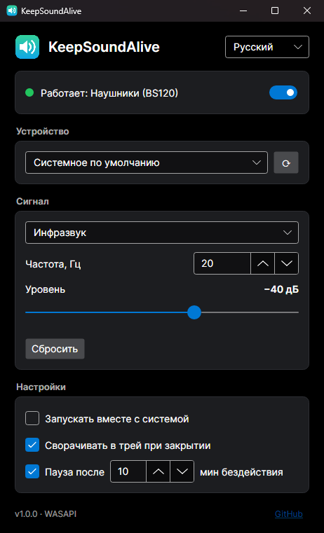

<p align="center">
  
</p>

<h1 align="center">KeepSoundAlive</h1>

<p align="center">
  Колонки не засыпают — звук больше не обрезается в начале.<br>
  Windows и Linux · один файл, ничего не нужно устанавливать
</p>

<p align="center">
  <a href="https://github.com/labpak/KeepSoundAlive/releases/latest"></a>
</p>

<p align="center"><a href="README.en.md">English</a></p>

<p align="center">
  
</p>

Многие колонки, саундбары, Bluetooth- и HDMI-устройства отключают усилитель после нескольких секунд тишины.
Когда звук появляется снова, им нужно 1–3 секунды, чтобы проснуться, и начало звука пропадает.
KeepSoundAlive подаёт на устройство неслышимый сигнал, и оно не засыпает.

## Скачать

| Система | Файл |
|---|---|
| **Windows 10 / 11** | [**KeepSoundAlive-win-x64.exe**](https://github.com/labpak/KeepSoundAlive/releases/latest/download/KeepSoundAlive-win-x64.exe) |
| **Linux** | [**KeepSoundAlive-linux-x64**](https://github.com/labpak/KeepSoundAlive/releases/latest/download/KeepSoundAlive-linux-x64) |
| Windows на ARM (Snapdragon, Surface Pro X) | [KeepSoundAlive-win-arm64.exe](https://github.com/labpak/KeepSoundAlive/releases/latest/download/KeepSoundAlive-win-arm64.exe) |
| Linux на ARM (Raspberry Pi 4/5, 64-bit) | [KeepSoundAlive-linux-arm64](https://github.com/labpak/KeepSoundAlive/releases/latest/download/KeepSoundAlive-linux-arm64) |

Если не уверены — берите первую строку для Windows или вторую для Linux.
Все версии: [Releases](https://github.com/labpak/KeepSoundAlive/releases).

## Установка

### Windows

1. Скачайте `KeepSoundAlive-win-x64.exe` и запустите.
2. Если появится окно «Windows защитила ваш компьютер», нажмите **Подробнее → Выполнить в любом случае**
   (у файла нет платной цифровой подписи).
3. Включите «Запускать вместе с системой» и закройте окно — программа останется в трее.

> Перед включением автозапуска положите файл туда, где он будет лежать постоянно (не в «Загрузки»).

**Или одной командой в PowerShell** — программа установится в `%LOCALAPPDATA%\Programs\KeepSoundAlive`,
появится в меню «Пуск» и запустится:

```powershell
irm https://raw.githubusercontent.com/labpak/KeepSoundAlive/main/install.ps1 | iex
```

### Linux

**Одной командой** — программа установится в `~/.local/bin`, появится в меню приложений и запустится:

```sh
curl -fsSL https://raw.githubusercontent.com/labpak/KeepSoundAlive/main/install.sh | sh
```

**Или вручную:**

```sh
chmod +x KeepSoundAlive-linux-x64
./KeepSoundAlive-linux-x64
```

Работает с PipeWire, PulseAudio и ALSA. На GNOME значок в трее появится только с расширением
[AppIndicator](https://extensions.gnome.org/extension/615/appindicator-support/); без него окно открывается
повторным запуском программы.

## Если колонки всё равно засыпают

- Поднимите **Уровень** на 5–10 дБ.
- Попробуйте другой **Сигнал**: «Тихий шум», а для проводных колонок — «Ультразвук».
- Если засыпает не колонка, а звук по HDMI или USB, достаточно режима «Тишина».
- Если колонки засыпают только после долгого простоя компьютера — это пауза, которая даёт Windows уйти в сон:
  сигнал останавливается, когда N минут нет ни движения мыши, ни звука из других программ.
  Увеличьте время или снимите галочку «Пауза после … мин бездействия».

## Удаление

- **Windows:** выключите «Запускать вместе с системой», закройте программу через трей и удалите exe.
  Настройки лежат в `%APPDATA%\KeepSoundAlive`.
- **Linux:** выключите автозапуск и пункт меню в настройках программы, удалите `~/.local/bin/KeepSoundAlive`
  и `~/.config/KeepSoundAlive`.

<details>
<summary><b>Командная строка</b></summary>

```
KeepSoundAlive [параметры]
  --minimized      запуск сразу в трей
  --headless       работа без окна с сохранёнными настройками (серверы, SSH); Ctrl+C для выхода
  --list-devices   список устройств вывода
  --add-to-menu    (Linux) добавить в меню приложений
  --help           справка
```
</details>

<details>
<summary><b>Сборка из исходников</b></summary>

Нужен [.NET SDK 10](https://dotnet.microsoft.com/download).

```sh
dotnet run --project src/KeepSoundAlive
dotnet publish src/KeepSoundAlive -c Release -r win-x64    # или linux-x64, win-arm64, linux-arm64
```

C# / .NET 10, [Avalonia UI](https://avaloniaui.net/), [NAudio](https://github.com/naudio/NAudio) на Windows,
libpulse / ALSA на Linux. Релиз собирается GitHub Actions при пуше тега `v*`.
</details>

## Лицензия

[MIT](LICENSE)
